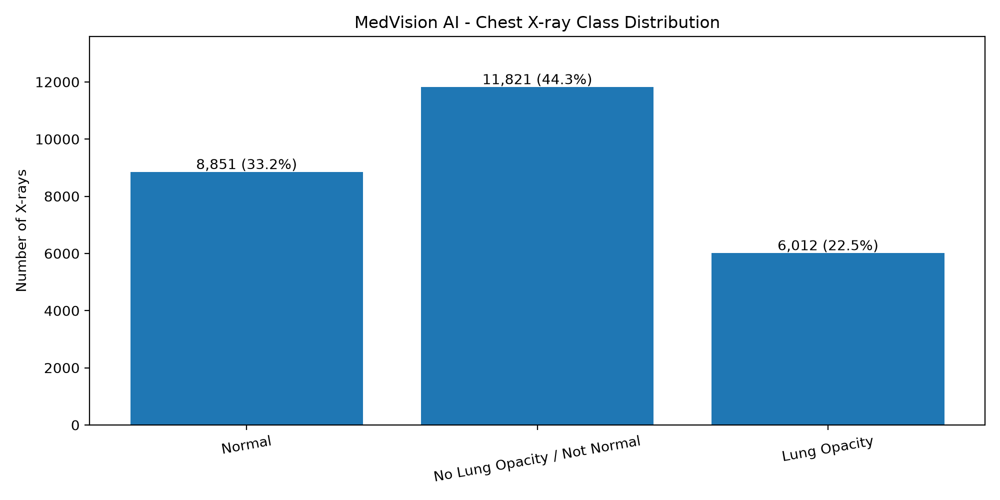
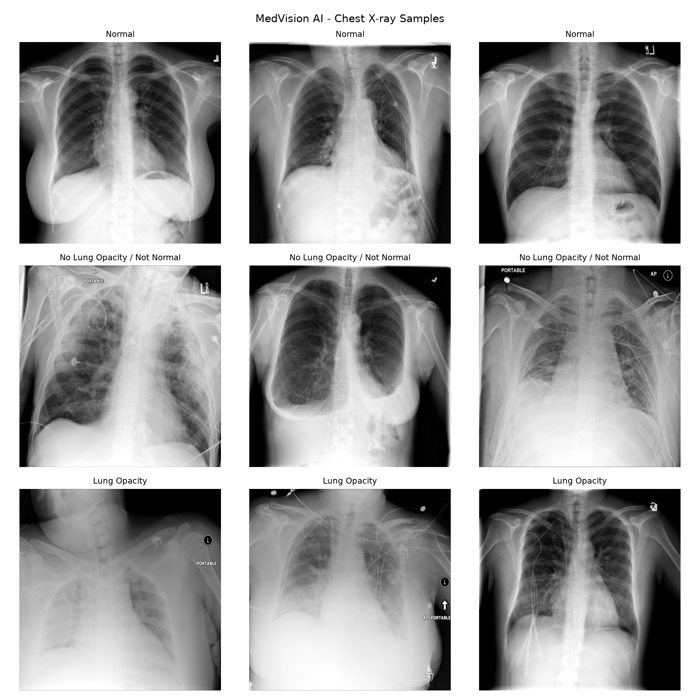
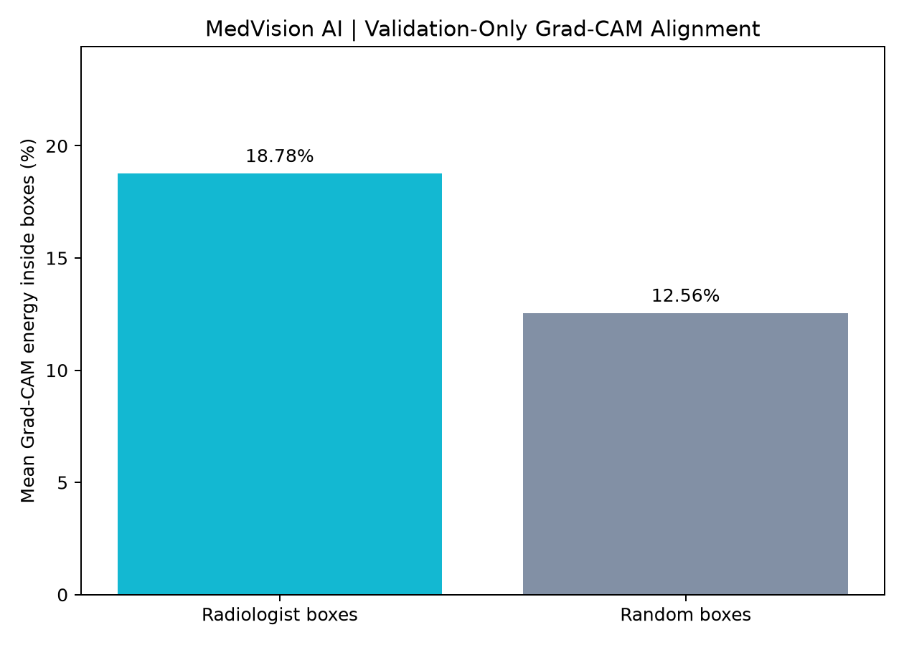

# MedVision AI

> **Chest X-ray Classification & Explainable AI Research**

PyTorch   ·   DenseNet121 V2   ·   Streamlit   ·   Grad-CAM

**LIVE DEMO:** https://medvision-ai2.streamlit.app/

**GITHUB:** https://github.com/adityabhati711-jpg/MedVision-AI

**DEVELOPER:** Aditya Bhati

> Educational research demonstration. Model predictions and attribution visualizations are not medical findings.

## 1. Project Overview

MedVision AI is an interactive research application for **three-class chest X-ray classification**. It combines a trained DenseNet121 V2 model with a Streamlit interface and Grad-CAM visual explanations. The platform demonstrates the inference workflow, shows held-out evaluation results, and presents a separate explainability research experiment.

**Core features:** Chest X-ray upload and classification; three-class model scores; Grad-CAM heatmap; model analytics; research findings and limitations.

## 2. Dataset & Data Preparation

The project uses the **RSNA Pneumonia Detection Challenge (2018)** chest X-ray dataset. The recorded class-distribution figure covers **26,684 images**:

| Class | Images | Share |
| --- | --- | --- |
| Normal | 8,851 | 33.2% |
| No Lung Opacity / Not Normal | 11,821 | 44.3% |
| Lung Opacity | 6,012 | 22.5% |

The preprocessing pipeline converts uploads to RGB, resizes images to **224 × 224 pixels**, converts them into tensors, and normalizes them using checkpoint-stored values. Training, validation, and test splits were audited for patient-identifier overlap; **4,003 images** formed the recorded held-out test set.



*Figure 1: Class distribution across 26,684 RSNA chest X-ray images.*

## 3. Model Architecture & Training

- **Deployed model:** DenseNet121 V2 (PyTorch), with a three-class classification head.
- **Input / output:** 224 × 224 RGB image → Lung Opacity, No Lung Opacity / Not Normal, or Normal.
- **Checkpoint:** Models/densenet121_v2_original_backup.pth; CPU inference.
- **Experiments:** DenseNet121 V2, weighted V3 and V4 were explored; **V2 is deployed**.

The checkpoint stores trained weights, class mapping and normalization values. Exact epochs, optimizer, learning rate and batch size have not been verified from the available public training files and are therefore not stated.



*Figure 2: Representative chest X-ray samples from the three classification categories.*

## 4. Model Evaluation

Recorded results for **DenseNet121 V2** on **4,003 held-out X-rays**:

| Metric | Result |
| --- | --- |
| Test accuracy | 73.15% |
| Macro F1-score | 0.7189 |
| Lung Opacity recall | 56.3% |
| Held-out images | 4,003 |

The lower Lung Opacity recall is a meaningful limitation: some opacity-labeled images were assigned to other classes. These metrics are from the held-out test evaluation, **not** from website uploads.


*Figure 3: DenseNet121 V2 confusion matrix on 4,003 held-out X-ray images.*

## 5. Explainable AI — Grad-CAM

The live app computes **Grad-CAM** using DenseNet121's final feature stage (model.features.norm5) for the predicted class. Its heatmap highlights regions contributing to the model output. Users can adjust overlay intensity. **These regions are attribution, not clinically verified lesions.**


*Figure 4: Original chest X-ray and corresponding DenseNet121 V2 Grad-CAM attribution heatmap.*

## 6. Historical ResNet18 Explainability Research

A **separate historical ResNet18 model** was examined on **100 Lung Opacity-labeled validation X-rays**. Grad-CAM energy inside radiologist annotation boxes averaged **18.78%**, versus **12.56%** for randomly placed boxes (**+6.22 percentage points**); **80 of 100** images favored annotated boxes. This is **not a DenseNet121 V2 result** and does not establish diagnostic or localization validity.



*Figure 5: ResNet18 Grad-CAM energy inside radiologist annotation boxes versus random boxes across 100 validation X-rays.*

## 7. How to use the live application

1. Open https://medvision-ai2.streamlit.app/ and select **AI Scanner**.
2. Upload a **chest X-ray** image in PNG, JPG or JPEG format.
3. Click **Analyze X-ray** to run the model.
4. Review the **predicted class** and three **uncalibrated model scores**.
5. Inspect the **Grad-CAM** heatmap; optionally adjust overlay intensity.
6. Use **Model Analytics** and **Research & Limitations** to explore the findings.

**Note:** The current deployed version does not reliably screen out non-X-ray uploads. Model scores must not be read as disease probabilities.


*Figure 6: MedVision AI Scanner displaying an uploaded chest X-ray, predicted class, and uncalibrated model scores.*

## 8. Local Installation

Clone the project, install its dependencies and launch Streamlit:

```bash
git clone https://github.com/adityabhati711-jpg/MedVision-AI.git
cd MedVision-AI
python -m pip install -r requirements.txt
streamlit run app/app.py
```

The application loads the included **DenseNet121 V2** checkpoint and uses CPU inference. Training datasets and historical ResNet18 checkpoints are excluded from the public repository; those research scripts need additional files.

## 9. Technology & Repository Structure

**Stack:** Python, PyTorch, Torchvision, NumPy, Streamlit, Plotly, Pillow and Grad-CAM.

```bash
MedVision-AI/
  app/app.py           Streamlit interface and inference
  Models/              Deployed DenseNet121 V2 checkpoint
  reports/             Saved figures and research results
  src/                 Research/evaluation utilities
  requirements.txt     Application dependencies
```

## 10. Project Scope & Future Enhancements

MedVision AI delivers an end-to-end research workflow: dataset preparation, DenseNet121 V2 evaluation, live inference, Grad-CAM, and a separate ResNet18 attribution study.

**Next development priorities:**

- **Model Optimization:** Explore class-balanced training and augmentation to strengthen Lung Opacity detection.
- **Broader Evaluation:** Test independent chest X-ray sources to study generalization beyond the current dataset.
- **Input Safeguards:** Add X-ray image-type screening and calibrated prediction scores.
- **Research Depth:** Expand Grad-CAM annotation comparisons and publish complete training settings when available.

These priorities build on the completed implementation and provide a focused research roadmap.

---

Developed by Aditya Bhati  •  Live demo: medvision-ai2.streamlit.app  •  GitHub: adityabhati711-jpg/MedVision-AI
